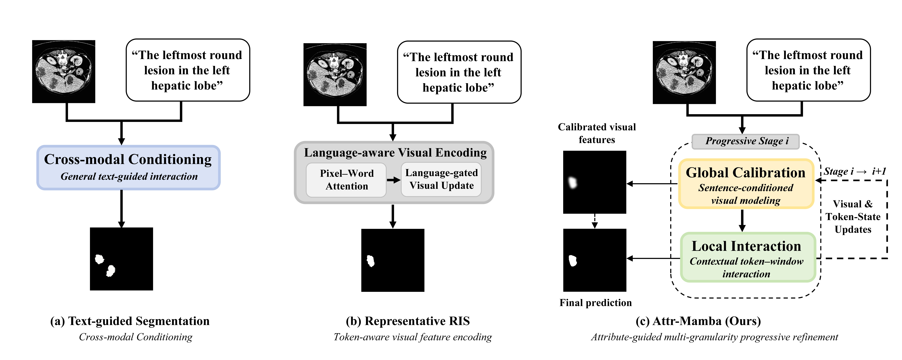
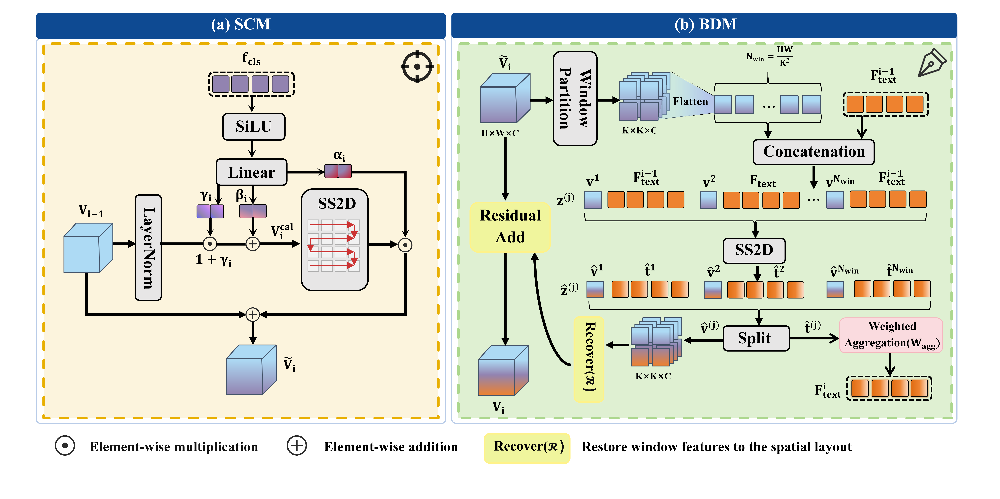
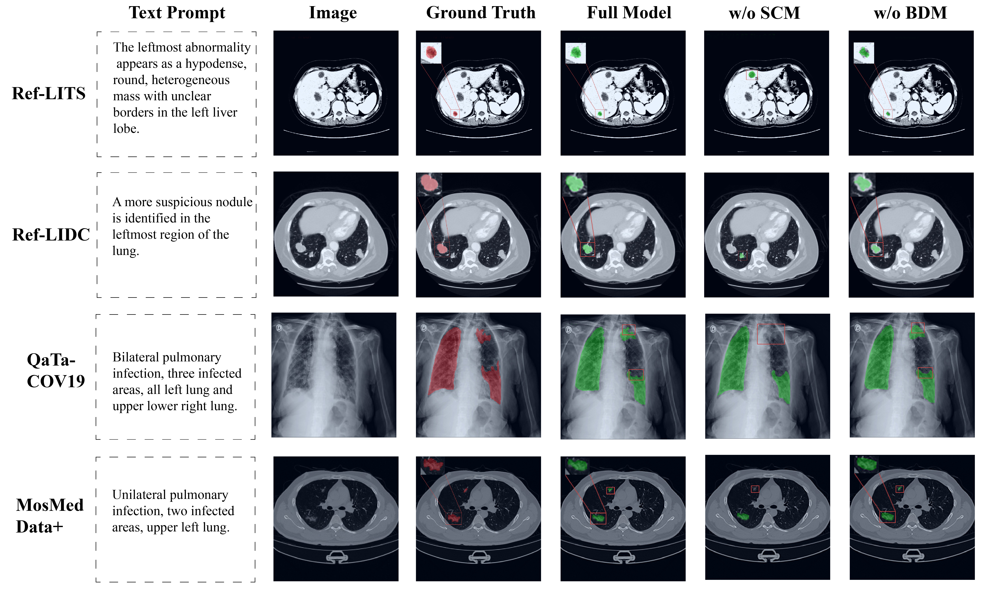
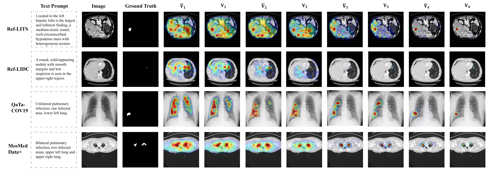
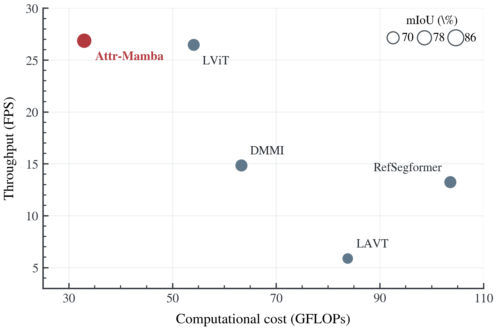
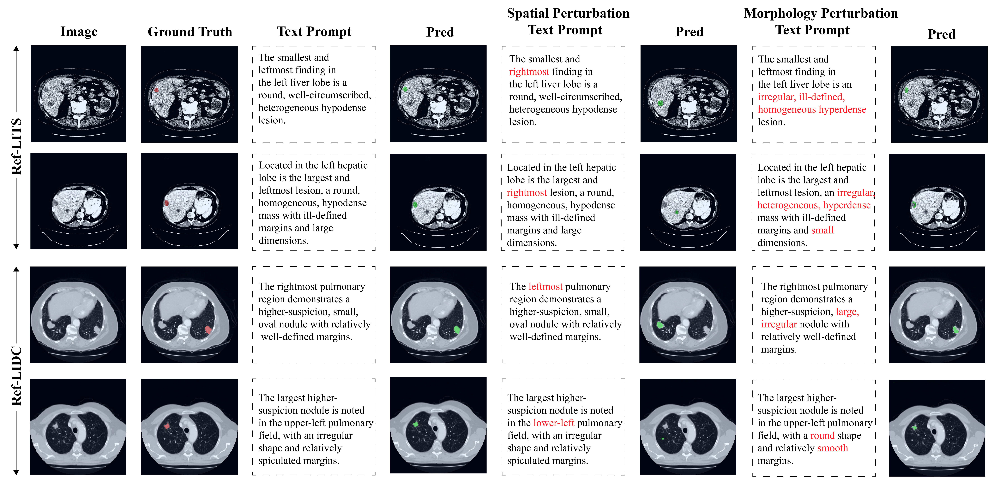

# Attr-Mamba

Official implementation of **Attr-Mamba: Attribute-Guided State Space Model for Progressive Medical Referring Image Segmentation**.

Attr-Mamba receives a medical image and a complete clinical-style referring description and progressively refines a text-conditioned segmentation mask. Sentence-level features are used for global semantic calibration, while token-level features from the same description are used for localized vision-language interaction. The two granularities are complementary representations, not manually separated anatomy and morphology word lists.

## Method

The released implementation follows the revised manuscript:

- **SCM:** sentence feature `f_cls` produces `(alpha, beta, gamma)` and calibrates the visual state before one SS2D residual update.
- **BDM:** visual windows are concatenated with all token features into one `N_win x (K^2 + L)` interaction grid. SS2D is applied to this packed grid, so the scan can propagate information across windows; visual states are restored and text states are aggregated with learned spatial weights.
- **Cascade:** SCM and BDM are applied successively at each decoding stage, with the updated token state passed to the next stage.
- **Objective:** `L = L_dice + L_focal + 0.1 L_boundary`, where the boundary weight map uses a radius-1 (3 x 3) square structuring element and `eta=5`.

<p align="center"></p>
<p align="center"><b>Conceptual comparison.</b> Attr-Mamba combines global text-conditioned localization with token-level boundary refinement.</p>

<p align="center"></p>
<p align="center"><b>Overall framework.</b> Complete descriptions generate sentence-level and token-level representations that are progressively updated by SCM and BDM.</p>

<p align="center"></p>
<p align="center"><b>SCM and BDM.</b> SCM performs global sentence-conditioned calibration; BDM performs token-level interaction on the packed visual-text grid.</p>

## Installation

Python 3.10 and a CUDA-compatible PyTorch installation are recommended. The selective-scan extension must be compiled with a CUDA toolkit compatible with the installed PyTorch version.

```bash
conda create -n attr-mamba python=3.10
conda activate attr-mamba
pip install -r requirements.txt
cd selective_scan && pip install . && cd ..
```

The model uses a frozen RadBERT text encoder and an ImageNet-pretrained Swin-T visual encoder. Supply their local paths with `--bert_path` and `--swin-pretrained` (or use the corresponding Hugging Face identifier for RadBERT).

## Training and evaluation

```bash
python -m torch.distributed.launch --nproc_per_node=2 --use_env main.py \
  --distributed --model AttrMamba --data-set ref-lits \
  --data-path /path/to/Ref-LITS --json-prefix ref_lits \
  --image-size 512 --output_dir ./outputs/ref_lits \
  --batch_size 4 --epochs 200 --lr 1e-4 --weight-decay 0.05
```

```bash
python main.py --eval --model AttrMamba --data-set ref-lits \
  --data-path /path/to/Ref-LITS --json-prefix ref_lits \
  --test-split test --resume ./outputs/ref_lits/best_checkpoint.pth
```

The default decoder has four cascaded stages. The implementation exposes the revision controls used for ablations:

```text
--num-stages {1,2,3,4,5,6}
--disable-scm       # bypass SCM; retraining is required for Table II-style ablations
--disable-bdm       # bypass BDM; retraining is required for Table II-style ablations
--text-mode {normal,empty,no-text}
--dump-stage-states # return stage states for visualization export
--deterministic     # deterministic cuDNN behavior for seed replication
```

`empty` tokenizes an empty description; `no-text` uses zero sentence/token conditioning. These are inference controls and should be reported separately from independently retrained module ablations. Segmentation masks use a sigmoid threshold of `0.5`, with no connected-component post-processing.

Validate the fixed manuscript protocol and convert saved stage states to heatmaps with:

```bash
python tools/validate_paper_protocol.py --strict
python tools/export_stage_states.py ./vis_results/ref_lits/stage_states/batch_00000.pt ./vis_results/ref_lits/heatmaps
```

## Dataset protocol

The public construction protocol and released descriptions are in [`dataset_protocol/`](dataset_protocol/). Images and masks remain subject to the licenses of their source datasets.

```bash
python dataset_protocol/scripts/validate_descriptions.py \
  --attributes dataset_protocol/examples/example_attributes.json \
  --descriptions dataset_protocol/examples/example_descriptions.json
python dataset_protocol/tools/audit_release.py dataset_protocol
```

## Results from the revised manuscript

All values below are reproduced under the unified evaluation protocol and are reported as mean ± standard deviation over five independently trained runs. mIoU and mDice are percentages; HD95 is in pixels.

| Dataset | mIoU | mDice | HD95 |
| --- | ---: | ---: | ---: |
| Ref-LITS | 69.62 ± 0.44 | 78.41 ± 0.56 | 10.20 ± 0.68 |
| Ref-LIDC | 63.44 ± 0.56 | 76.07 ± 0.62 | 7.04 ± 0.61 |
| QaTa-COV19 | 85.77 ± 0.64 | 92.15 ± 0.76 | 11.63 ± 0.72 |
| MosMedData+ | 66.01 ± 0.49 | 79.51 ± 0.52 | 13.19 ± 0.69 |

These comparisons are limited to the methods reproduced under the same protocol; they do not claim to exceed every value reported in the original papers.

<p align="center"></p>
<p align="center"><b>Qualitative comparison.</b> The figure uses the revised manuscript's TP/FN/FP overlay convention.</p>

### SCM/BDM ablation

The following rows are independent retraining variants; the full progressive decoder and training protocol are retained while only the indicated module is bypassed.

| SCM | BDM | Ref-LITS mIoU | Ref-LITS mDice | Ref-LITS HD95 | Ref-LIDC mIoU | Ref-LIDC mDice | Ref-LIDC HD95 |
| --- | --- | ---: | ---: | ---: | ---: | ---: | ---: |
| – | – | 57.11 ± 0.61 | 66.72 ± 0.63 | 15.67 ± 0.74 | 53.96 ± 0.61 | 68.03 ± 0.75 | 13.95 ± 0.96 |
| ✓ | – | 59.73 ± 0.39 | 69.71 ± 0.59 | 14.24 ± 0.85 | 55.93 ± 0.79 | 70.88 ± 0.49 | 12.57 ± 0.75 |
| – | ✓ | 62.94 ± 0.56 | 72.93 ± 0.72 | 13.03 ± 0.76 | 57.07 ± 0.55 | 71.54 ± 0.65 | 11.82 ± 0.59 |
| ✓ | ✓ | 69.62 ± 0.44 | 78.41 ± 0.56 | 10.20 ± 0.68 | 63.44 ± 0.56 | 76.07 ± 0.62 | 7.04 ± 0.61 |

<p align="center"></p>
<p align="center"><b>Module ablation visualization.</b> Removing SCM or BDM changes localization and boundary behavior in the qualitative examples.</p>

### Progressive decoding and efficiency

| Stages | mIoU | mDice | HD95 | Params (M) | GFLOPs |
| ---: | ---: | ---: | ---: | ---: | ---: |
| 1 | 65.51 ± 0.58 | 74.72 ± 0.67 | 13.89 ± 0.82 | 184.16 | 211.73 |
| 2 | 66.72 ± 0.54 | 76.03 ± 0.57 | 12.94 ± 0.78 | 185.85 | 212.21 |
| 3 | 68.03 ± 0.49 | 77.46 ± 0.59 | 11.72 ± 0.73 | 192.12 | 213.64 |
| 4 (default) | 69.62 ± 0.44 | 78.41 ± 0.56 | 10.20 ± 0.68 | 216.20 | 219.89 |

<p align="center"></p>
<p align="center"><b>Stage-wise states.</b> Intermediate visual states become progressively concentrated around the referred target.</p>

<p align="center"></p>
<p align="center"><b>Efficiency comparison on QaTa-COV19.</b> The reported setting is 224 × 224; the exact protocol is specified in the manuscript.</p>

### Mamba versus MHSA

The operator ablation replaces SS2D in SCM and/or BDM while preserving the surrounding module structure, input organization, training protocol, and four-stage decoder. On Ref-LITS, the four combinations obtain mIoU/mDice/HD95 of `67.83/76.95/11.36` (MHSA/MHSA), `68.64/77.63/10.76` (MHSA/Mamba), `68.91/77.80/10.71` (Mamba/MHSA), and `69.62/78.41/10.20` (Mamba/Mamba). The BDM comparison uses the complete packed `N_win × (K²+L)` grid; MHSA baselines use the matched input organization described in the manuscript.

### Text sensitivity and robustness

<p align="center"></p>

On the matched prompt-perturbation subsets, Ref-LITS obtains `76.96/86.31/2.15/78.05/6.19` for original text and `45.78/50.90/80.34/42.13/86.54` under spatial perturbation (mIoU/mDice/CD/BF/HD95). Morphology perturbation obtains `70.35/79.26/12.91/68.00/19.14`. Ref-LIDC values are provided in the manuscript table.

For clinical/noisy text, each setting contains 2,000 image-text evaluations (400 held-out instances × five independently written descriptions), and the same 400 instances are reused for original prompts. Results are averaged within each run and summarized across the five trained seeds. This distinction is important: these are fixed-model inference evaluations, not additional retraining runs.

## Reproducibility details

- Separate training is performed for each dataset; the default protocol uses AdamW, learning rate `1e-4`, weight decay `0.05`, up to 200 epochs with early stopping, and total batch size 4 on two RTX 3090 GPUs.
- Each experiment is independently repeated with five random seeds and reported as mean ± standard deviation.
- Boundary F-score uses a 2-pixel matching tolerance; HD95 and CD use the resized image coordinates. Empty-mask handling follows the manuscript protocol.
- Ref-LITS/Ref-LIDC use 512 × 512 input; QaTa-COV19/MosMedData+ use 224 × 224 input.
- Images are resized bilinearly and masks with nearest-neighbor interpolation. No connected-component selection or hidden post-processing is used.

## Citation

If this code or protocol is useful for your research, please cite the Attr-Mamba paper after publication.

## Acknowledgements

This implementation builds on open-source Swin Transformer, VMamba/selective-scan, RadBERT, and referring image segmentation components. Please follow the licenses of the respective projects and datasets.
